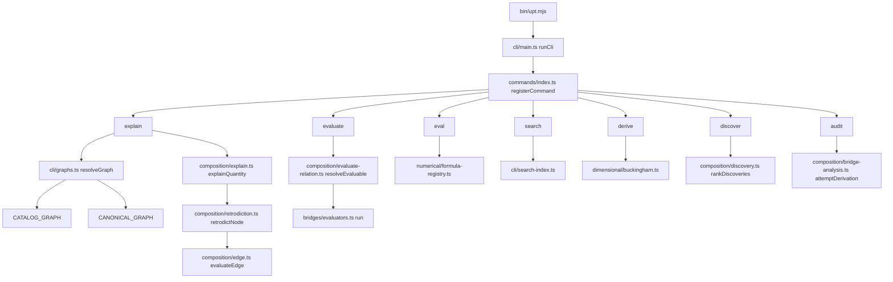

# Integration map

This document shows how the library runs. It names the owner of each concept that more than one module could implement. It also lists the names that more than one file declares.

The document holds no source counts. `DEPENDENCY_GRAPH.md`, `TEST_COVERAGE.md` and `unused-analysis.md` hold them, and `bun run docs:deps` writes them. `tests/fixtures/catalog-census.json` holds the catalog counts. `duplicate-owners.md` is the generated scan of the single-owner rules below. `duplicate-symbols.md` lists the names that more than one file declares.

---

## 1. Modules, entries and runtime flow

### What each module is

| Module | Role | Public entry |
|---|---|---|
| `entry` (`src/index.ts`) | Package root. Re-exports the library surface. Does not re-export `MathTSEngine` | `package.json` `"."` |
| `root` (`src/cli-api.ts`) | Barrel that the CLI injects as `CommandCtx.api`. `src/cli/main.ts` is the only module in `src/` that imports the barrel as a value. The other importers use `import type` | not a package export |
| `cli` | Command registry and one module per command | `bin/upt.mjs` → `dist/cli/main.js` |
| `bridges` | Catalog projections: rows (`BRIDGE_EQUATIONS`), right-hand-side trees, closed-form evaluators, confrontations, and the loader | named exports from `src/index.ts` |
| `canonical` | Textbook L-layer equations that the catalog is checked against | `CANONICAL_EQUATIONS` and accessors |
| `composition` | `Quantity`, `BridgeEdge`, `CATALOG_GRAPH`, `CANONICAL_GRAPH`, explain, discover, audit derivation, `evaluateRelation` | `explainQuantity`, the graphs, `rankDiscoveries` |
| `dimensional` | SI dimension, `ExprNode`, validator, units, Buckingham-π | `validate`, `convertValue`, algebra |
| `numerical` | `TensorEngine` and `MathTSEngine`, formula parser, geodesics, GL4, curvature lowering | `MathTSEngine` only on the `numerical/mathts-engine` subpath |
| `atlas` | Relations between models (`ab-*`), evidence tags, witnesses, benchmark | namespace `atlas` from `src/atlas/public.ts`; full barrel on subpath `./atlas` |
| `relations` | Shared relation vocabulary that the atlas shims re-export | the types `RelationContract` and `Conventions` from `src/index.ts`; the values through atlas and `cli-api` |
| `cases` | Applied-case evaluators (`upt evaluate case-*`) | `APPLIED_CASES` through `cli-api`. The package root does not export it |
| `core` | `UniversalTensor`, SI constants, labeled tensors, hashing | constants and tensor types |
| `diff` | Bridge gradients: exact AD over the right-hand-side tree through MathTS autograd, and central finite differences | gradient helpers that the root exports |

`MathTSEngine` (`src/numerical/mathts-engine.ts`) is the only class in `src/` that implements `TensorEngine`.

### Dispatch

`bin/upt.mjs` loads `dist/cli/main.js` and assigns the returned code to `process.exitCode`. `runCli` (`src/cli/main.ts`) imports `src/cli/commands/index.ts`. That module imports each command module for its side effect. Each command module calls `registerCommand` (`src/cli/command.ts`). `resolveCommand` finds a command by name. `docs/CLI.md` is the generated command reference.

`main.ts` handles `help` and `version` before the registry. The `chain` command is registered, but the command does not run the chain orchestrator. The command prints that the orchestrator is internal, cites the design note and exits 2.

### `upt explain`

1. `bridgeRedirect` (`src/cli/commands/explain.ts`) recognizes a bridge id before the command reads a graph. The id is `be-<n>` in any letter case, or the bare number `<n>` (`catalogIdNumber` in `src/bridges/catalog-load.ts`). A bridge id names an edge, and explain derives quantities. The command therefore prints a hint from `auditCoverage` and exits 0.
2. `resolveGraph` (`src/cli/graphs.ts`) reads `--source`. The default is `catalog`. `canonical` uses `CANONICAL_GRAPH`. `both` joins the two graphs.
3. `resolveQuantityName` (`src/dimensional/formula-names.ts`) resolves the target name. `nearQuantityNames` (`src/composition/aliases.ts`) lists the quantities within one edit of the target. The target resolves when it has no hyphen, underscore or space and the list holds one quantity. A target with one of those characters stays a suggestion. On a miss, the command adds the `upt search` hits from `searchNameWords` (`src/cli/search-index.ts`) and exits 1 with NOT COVERED.
4. `readNamedBinding` reads the inputs and applies the temperature reading.
5. `explainQuantity` (`src/composition/explain.ts`) classifies identifiability and calls `retrodictNode` (`src/composition/retrodiction.ts`). `retrodictNode` calls `evaluateEdge` (`src/composition/edge.ts`).

Catalog edges and canonical edges share `evaluateEdge`. Only the graph argument differs. The closed-form catalog evaluators are not on this path.

### `upt evaluate` and `upt eval`

`evaluate` and `eval` are different commands.

`upt evaluate` resolves an id with `resolveEvaluable` (`src/composition/evaluate-relation.ts`) and runs the `run` function of the evaluator. `resolveEvaluatorInputs` (`src/bridges/evaluator-inputs.ts`) reads the inputs through `readNamedBinding`. `missingEvaluatorMessage` words the refusal for an id that has no evaluator. `upt evaluate` with no argument lists `BRIDGE_EVALUATORS` and `APPLIED_CASES`. The help text shows a range label from `closedFormRangeLabel` (`src/cli/closed-form-range.ts`), which also reads `BRIDGE_EVALUATORS`. Neither keeps a second list of ids.

`--sigma` calls `propagateEvaluatorUncertainty` (`src/numerical/evaluator-uncertainty.ts`). That function calls MathTS `propagateUncertainty`. `readNamedBinding` reads the sigma value with the difference reading. The graph layer has a different function, `propagateUncertainty` in `src/composition/uncertainty.ts`.

`upt eval` parses a user formula. `getFormulaParser` (`src/numerical/formula-registry.ts`) returns the MathTS parser. `readNamedBinding` reads the bindings.

### `upt search`

`buildSearchIndex` (`src/cli/search-index.ts`) indexes catalog rows, canonical equations, atlas families, the quantities of both graphs, regime registrations and applied cases. A trailing parenthetical on a catalog or canonical name is a gloss field (`titleAndGloss`). A catalog row suggests one command:

- `upt evaluate be-<n>` when the id is in `BRIDGE_EVALUATORS`
- `upt atlas be-<n>` when the row has a `catalogFormalRef`
- `upt explain be-<n>` in every other case

`matchEveryWord` requires every word of a query to match. One word of three or more letters matches as a word or as a proper prefix. A word of one or two letters matches only exactly. Two or more words match only as whole words. When two or more words sit in one field, they have to form a contiguous run in that field. A gloss field matches only a query whose words form a run in the gloss. Words in different fields that are not glosses still match together. A hit on an id comes first, and so does a hit on a name that has no hit on the description. Search does not rank by edit distance. Explain uses `editDistance` through `nearQuantityNames`.

### `upt derive`

`dimensionallyDetermines` (`src/dimensional/buckingham.ts`) runs first. When the inputs do not fix one monomial, `buckinghamPi` lists the free groups. With `--formula`, the command rewrites declared hyphenated names to underscores (`rewriteCatalogHyphens`). The same function rewrites the hyphenated spelling of a registered constant to the primary name of the constant: `reduced-planck-constant` becomes `hbar`. Then the command checks the dimension of the formula with the checker from `getFormulaDimensionChecker`. The MathTS parser parses the formula. `recoverMonomialPrefactor` (`src/canonical/fixed-points.ts`) recovers the prefactor when one monomial exists. `compareWithCanonical` and `matchingCatalogEdges` report the known relations. `classifyDetermination` (`src/cli/determination.ts`) selects the exit class.

### `upt discover`

`resolveGraph` selects the edge list. `rankDiscoveries` (`src/composition/discovery.ts`) builds a context and ranks the link candidates from `proposeLinkCandidates` (`src/composition/bridge-analysis.ts`). `--derive` calls `deriveProposedBridges`. Anchor values come from `readNamedBinding` (`src/cli/commands/_discovery-opts.ts`).

### `upt audit`

For each edge, `attemptDerivation` (`src/composition/bridge-analysis.ts`) and `dimensionalFreedom` run. A dimensional sum returns `not-a-monomial`. An edge with `coefficientUnset` returns `coefficient-unset` before any ratio check. A missing coefficient is not the constant 1, so the evaluator returns no number.

### Library API and CLI barrel

`src/index.ts` exports the catalog, both graphs, `explainQuantity`, `evaluateRelation`, `rankDiscoveries`, the dimensional validation and the `atlas` namespace. `src/cli-api.ts` re-exports much of that surface. `src/cli-api.ts` also exports six helpers that the package root does not export: `evaluateBridge`, `attemptDerivation`, `getFormulaParser`, `compareWithCanonical`, `readBinding` and `readNamedBinding`. The barrel exports the probe stack and the atlas path and regime surface too. The `./probe` and `./atlas` subpaths make part of the probe and atlas surface public, and the `atlas` namespace exports `regimeHolds`.

A command receives the barrel as `ctx.api`. No module under `src/cli/commands/` imports a value from `src/` outside `src/cli/`. A command imports types with `import type`. Some commands import `src/cli/library-defaults.ts` and `src/cli/closed-form-range.ts`, and those two modules import library values for help text.

---

## 2. Concepts with one owner

Each concept below has one owner. A module that needs the concept calls the owner.

### Unit parsing and temperature

`src/dimensional/units.ts` holds the unit grammar over the table in `data/units.json`. `parseUnit`, `convertValue` and the binding reader share `readUnit` over exact scales (`src/dimensional/exact-scale.ts`). Each scale is an exact rational times at most one irrational factor, rounded once. `units.ts` imports no MathTS package. `exact-scale.ts` imports `gcd` from `@danielsimonjr/mathts-functions`.

A bare token that is one factor stays that factor (`ms`, `mm`, `mK`, `Ts`). Inside a compound, a prefixed factor competes with a heterogeneous product. `parseUnit('W/mK')` is therefore ambiguous, and `convertValue` keeps the reading whose dimension is the declared unit. A homogeneous power does not compete (`mm` stays a millimetre). Any other token with exactly one split is a product (`m2K`, `Vs`, `cm^2/Vs`). A token with more than one split is a named refusal (`mAs`). The Celsius offset is `unitTables().celsiusOffsetK`. Fahrenheit is the same affine table with scale 5/9 and offset 273.15 − 32×5/9.

`readBinding` (`src/numerical/binding-value.ts`) accepts a bare number, a number with a unit, or an expression. For an expression, it splices out the unit literals and parses the rest with the MathTS formula parser. `bindingInUnit` uses `convertValue` for a plain number with a unit and `readBinding` for an expression.

`readNamedBinding` chooses an absolute or a difference reading from `temperatureQuantityRole`, unless the caller passes a reading. `--sigma` passes the difference reading. `readNamedBinding` converts a plain number with a unit into the declared unit when the dimensions match. A declared unit takes precedence. When the caller declares none, the target comes from `quantityConventionUnit`. That function reads the table `QUANTITY_CONVENTION_UNIT` (`src/dimensional/unit-convention.ts`): GeV energies, bit, nat, and one entropy in J/K.

`alignTemperatureBinding` divides an energy by `k_B` in two cases. The first case is a name for which `isTemperatureName` is true. The second case is a declared unit whose dimension is temperature. `isTemperatureName` is true for the synonym group that holds `temperature`. `readNamedBinding` is the only caller of `alignTemperatureBinding`.

These callers use `readNamedBinding`: `upt eval`, `upt explain`, discovery and map anchors, regime coordinates, a path sweep, `upt evaluate` and `--sigma`. A regime coordinate and a path `--at` read through `parseAt` (`src/cli/commands/regime.ts`). A path tolerance (`parseTolerance` in `src/cli/commands/path.ts`) reads through `readBinding` and is not a temperature slot.

`boltzmannBindingScale` chooses the scale. It prefers a bare or J/K spelling from the Boltzmann synonym group, in group order. It refuses two such spellings that disagree. With none of them, it uses the CODATA value.

A temperature of `10eV` is therefore kelvin on explain, eval, evaluate, a discovery anchor, a regime coordinate, a path sweep and `--sigma`. `bindingInUnit('10eV', 'K')` throws.

### Quantity names and aliases

`NAME_TABLE` (`src/composition/aliases.ts`) is the name table.

| Record | What it maps |
|---|---|
| synonym groups | `SYNONYM_GROUPS` (`src/dimensional/formula-names.ts`) comes from the aliases in `data/quantities.json` and from the spellings of each constant that names a quantity. `NAME_TABLE.synonyms` is that array. `resolveQuantityName` resolves a spelling to the member that the catalog or the parameter list holds. `shareSynonyms` (`src/composition/aliases.ts`) copies a value onto the other spelling of a group when the caller names exactly one. `collapseSynonymGovernors` (same file) keeps one spelling of a group in a governing set. `assertSynonymAgreement` refuses two spellings of one group that carry different numbers |
| comparison targets | `CE-sound-speed` answers to `speed`. `speed` is not a synonym of `sound-speed`. `CE-schwarzschild-radius` answers to `schwarzschild-radius`. `CE-compton-wavelength-full` answers to `compton-wavelength`, and `CE-compton-wavelength` answers to `reduced-compton-wavelength`. The `targetAliases` field of each entry holds these names, and `NAME_TABLE.canonicalTargets` projects them. `compareWithCanonical` reads the list |
| dimension renames | `T` with a temperature dimension is `temperature`. `M` and `m_1` with a mass dimension are `mass`. `m_2` is `secondary-mass`. `DIMENSION_RENAMES` in `src/dimensional/formula-names.ts` holds the rows, and `NAME_TABLE` includes that array. `canonicalQuantityName` (`src/canonical/normal-form.ts`) reads the array. A canonical file cannot import composition, so the rows stay in the dimensional tier. The layer allow-list holds one exception: `src/canonical/linkage.ts` imports `src/composition/expr-eval.ts`. A time coordinate named `T` stays `T` |

`edge.aliases` stays on each `BridgeEdge`. `aliasesForTarget` reads the aliases, and `resolveQuantityName` takes that map as its third argument. An evaluator key such as `B_T` is an alias on the edge record and not a second table.

`editDistance` (`src/composition/aliases.ts`) is optimal string alignment and is the only edit-distance function. An adjacent transposition is one edit. The distance from `lenght` to `length` is 1, and the distance from `lxxgth` to `length` is 2. `nearQuantityNames` resolves a name within one edit. `suggestQuantities` (`src/composition/user-equation.ts`) calls `editDistance` through `rankByName`. `rankByName` accepts a distance up to `max(1, ceil(length/2))`, or a name that contains the other name (at least three characters). Edit distance ranks first, then containment, then length. These rules apply to suggestions only. Explain uses `nearQuantityNames` and, on a miss, the search word index.

`SOURCE_ALIAS_DISPOSITIONS` (`src/composition/compose.ts`) is the table in which composition would record a name collision. The table is empty. `FORMULA_NAMED` (`src/dimensional/formula-names.ts`) names the registered constants that are not canonical, for the formula parser (`m_p`, `N_A`). A trailing parenthetical on a name is a gloss for `src/cli/search-index.ts`, and the printed line keeps the full name.

### Sign rules

`CarrierSignError`, `sameCarrierSign`, `assertSameCarrierSign` and `applyCarrierSignPolicy` are in `src/bridges/carrier-sign.ts`. `applyCarrierSignPolicy` is the only caller of `assertSameCarrierSign`.

| Check | Behavior |
|---|---|
| `sameCarrierSign` | Returns a boolean. The product must be at least zero |
| `assertSameCarrierSign` | Throws `RangeError` for an operand that is not finite. Throws `CarrierSignError` when the product is negative. `applyCarrierSignPolicy` is the only caller |
| `applyCarrierSignPolicy` | The one policy. A monomial that is odd in both `charge` and `carrier-mobility` rejects opposite signs. An explicit pair is that check for the Einstein relation. An input that the scalar tree is even in becomes an absolute value |

A canonical edge calls the policy once, in the `evaluate` function that `toEdge` (`src/composition/canonical-graph.ts`) builds. `evaluateEdge` calls that function. Explain and a direct `edge.evaluate` are therefore the same call. A catalog relation calls the policy once, inside `evaluateCatalogRelation` (`src/bridges/relation-eval.ts`). The `holds` string of the relation is the domain.

Hall and cyclotron results stay signed. Plasma frequency and Larmor radius are positive magnitudes. Conductivity refuses opposite signs with `charge and carrier-mobility must have the same sign`. The Einstein relation refuses them with `carrier-charge (q_C) and electrical-mobility (mu_m2_per_Vs) must have the same sign`.

### Coefficients and prefactors

`canonicalPrefactor` (`src/composition/canonical-prefactors.ts`) reads the sourced `prefactor` field of each canonical entry. The entry is the table. `CANONICAL_GROUP_PREFACTORS` lists the `groupPrefactor` field of each canonical entry. `CE-sound-speed` holds the group `gamma` with exponent 1/2. `canonicalGroupPrefactor` returns the factor for a bound group value.

The canonical `makeEvaluate` (`src/composition/canonical-graph.ts`) multiplies the recorded coefficient and `canonicalPrefactor(eq.id)` only when each one is defined. It multiplies the group prefactor when the group input is present. With no group input, the result is unset and `coefficientUnset` stays set. `forwardEvaluate` and `retrodictNode` (`src/composition/retrodiction.ts`) copy the group from the ground truth, because the group is not a source.

`toEdge` sets `coefficientUnset` when the entry is dimensional and has no sourced prefactor. A dimensional entry in that state returns no number unless its group is bound. Explain of that row prints no recovered number and says that the factor is unset. `attemptDerivation` returns `coefficient-unset` without a comparison of values.

`recordedDimensionlessCoefficient` returns the closed coefficient of a fully-quantitative tree when no sourced prefactor exists. `makeEvaluate` evaluates a fully-quantitative entry whose tree is a monomial with `evaluateAstMonomial` when the tree adds a count or the catalog monomial is null. `evaluateClosedScalar` evaluates a tree that is not a monomial, such as a sum or a transcendental. Otherwise `makeEvaluate` reads `eq.dimensional.monomial`. A dimensionless count on the scalar tree is a source in `formulaFactors`. `CE-ideal-gas` encodes `P = N k_B T / V`. Without `N`, the result is not `k_B T / V`. Hawking temperature keeps its factor `8π`. Newton's law returns `G m₁ m₂ / r²`.

A catalog closed form holds its factors inside the relation expression in `data/bridge-catalog.json`. The expression does not read `canonicalPrefactor`. `upt eval` uses the CODATA scope in `src/cli/eval-numbers.ts` and does not read that table either.

`formulaShape` (`src/composition/formula-shape.ts`) classifies a sum of dimensionful terms, and audit uses the classification. The formally-proved filter reads the Lean kind and ignores this classification.

### Bridge registration

A catalog id is a number on `BridgeEquationEntry`. The string `be-<n>` is the graph id. Atlas ids are `ab-*` and are not catalog rows. The catalog rows, the right-hand-side trees, the evaluators and the graph edges are projections of `data/bridge-catalog.json`. A new bridge is a new record in that file.

| Layer | Object | File | Joined by `getBridge`? |
|---|---|---|---|
| Catalog row | `BRIDGE_EQUATIONS` | `src/bridges/index.ts` | yes (`src/composition/descriptor.ts`) |
| Right-hand-side tree | `BRIDGE_RHS_BY_ID` | `src/bridges/rhs-registry.ts` | yes |
| CLI evaluator | `BRIDGE_EVALUATORS` | `src/bridges/evaluators.ts` | no |
| Public evaluation | `evaluateRelation` | `src/composition/evaluate-relation.ts` | no |
| Graph edge | `BridgeEdge` in `CATALOG_GRAPH` | `src/composition/catalog-graph.ts` | yes, by `beId` |
| Canonical equation | `CanonicalEquation`, optional `restatesBridge` | `src/canonical/` | no |
| Formal reference | `catalogFormalRef(n)` | `src/atlas/catalog-formal-ref.ts` | no. The catalog row stores a `formalKey`, and `catalogFormalRef` builds the reference from the manifest |
| Atlas bridge | `AtlasBridge` (`src/atlas/types.ts`), listed in `ATLAS_FAMILIES` | `src/atlas/families.ts` and the three families | no. `getBridge` accepts catalog ids only |

`getBridge` is one function, in `src/composition/descriptor.ts`. `restatesBridge` on a canonical entry holds the numeric string (`'16'`, not `'be-16'`). `rg 'restatesBridge:' src/canonical/entries` lists the entries that set it.

`be-16` (Landauer) shows the layers:

- the catalog row and its right-hand-side tree
- the evaluator: `evaluateRelation('be-16', { temperature: 300 })` is the public call
- the graph edge, which is the catalog relation `be-16` that `src/composition/catalog-graph.ts` projects
- `CE-landauer` with `restatesBridge: '16'` in `src/canonical/entries/thermo-nuclear-cosmo.ts`
- `catalogFormalRef(16)`

The canonical target is `erasure-energy`. The graph quantity is `landauer-erasure-energy`, a row of `data/quantities.json` that `src/composition/quantities.ts` projects. `targetThroughRestatedBridge` (`src/composition/canonical-compare.ts`) records that split.

`be-83` (Thomson) has a catalog row, an evaluator, a catalog relation of kind `law` in `CATALOG_GRAPH`, a primary-relation expression in `BRIDGE_RHS_BY_ID`, and `catalogFormalRef(83)`. The dependency of the row on `be-73` is a different fact from whether the two edges compose.

`ab-spring-lc` is an atlas bridge with `physjsFormalRef('ab-spring-lc')` (`src/atlas/oscillators/bridges-exact.ts`). The bridge is not a catalog row and not a `CATALOG_GRAPH` edge (`src/composition/not-composable-seeds.ts`).

### `MASS_DENSITY`

`MASS_DENSITY` is `{L:-3, M:1, T:0, I:0, Theta:0, N:0, J:0}`, declared once in `src/dimensional/types.ts`. `MASS_DENSITY` is not a row of `NAMED_DIMENSIONS`, so `format()` has no name for it. Eight modules import the constant. `rg MASS_DENSITY src` lists them.

### `canonicalJson` and `captureEnvironment`

`src/composition/canonical-json.ts` defines both names, with two profiles. The `record` profile keeps the bytes that the CLI record hashes. The `probe` profile writes a date as an ISO string and an undefined hole as `null`. The probe subpath re-exports the names as the probe profile. A merge of the two profiles without names would change the record fingerprints or the probe hashes.

### CLI plumbing

`renderTopLevelHelp` (`src/cli/top-level-help.ts`) renders top-level help from the command registry. `resolveGraph` reads `--source`. `describeKnownRelation` (`src/composition/canonical-compare.ts`) prints the known-relation text for derive and map. `registerRegimeDomain` (`src/relations/regime-registration.ts`) holds the regime names.

### Names that more than one file declares

Three groups of names have more than one declaration:

- `command` is one declaration for each CLI command module, by the registration convention.
- `sha256Hex` is a function in `src/composition/canonical-json.ts` and in `src/core/hash.ts`.
- Ten type names are forwarding aliases between `src/atlas/{types,composition-table,regime}.ts` and the files in `src/relations/`.

`duplicate-symbols.md` is the generated list.

---

## 3. MathTS boundary

MathTS packages are required dependencies. `package.json` lists nine `@danielsimonjr/mathts-*` packages. `src/` imports `mathts-functions`, `mathts-core`, `mathts-autograd`, `mathts-tensor`, `mathts-expression` and `mathts-matrix`. `src/numerical/evaluator-uncertainty.ts` imports `eigvals` from `mathts-matrix`. No file in `src/` imports `mathts-wasm`, `mathts-parallel` or `mathts-workerpool`.

`getFormulaParserKind` (`src/numerical/formula-registry.ts`) returns `'mathts'` only. The library has no second formula parser. `src/numerical/formula-contract.ts` holds the shared function table `SCALAR_FUNCTIONS` (`ln` is one entry) and the dispatcher `callBuiltinFunction`. The file is not a parser.

The API walk of the project generator (`--api-surface`) lists an external specifier only when a module re-exports from that specifier. `src/numerical/gl4-integrator.ts` re-exports `GL4_A`, `GL4_B` and `GL4_C` from `@danielsimonjr/mathts-functions`. That re-export is the one such case. A plain import does not appear in the report.

### Delegated

| UPT function | MathTS symbol | File |
|---|---|---|
| `propagateUncertainty` | `propagateUncertainty` | `src/composition/uncertainty.ts` |
| `propagateEvaluatorUncertainty` | `propagateUncertainty`, `eigvals` | `src/numerical/evaluator-uncertainty.ts` |
| `nullSpace` inside Buckingham-π | `rationalNullspace`, `Fraction` | `src/dimensional/buckingham.ts` |
| `rk4Trajectory` | `solveODESystem` with `dt` | `src/numerical/rk4-trajectory.ts` |
| `gl4Step`, `integrateGeodesicGL4` | `gaussLegendre4` (and the re-exported `GL4_A`, `GL4_B`, `GL4_C`) | `src/numerical/gl4-integrator.ts` |
| 16-point nodes | `rootsLegendre` | `src/numerical/quadrature.ts` |
| formula parse and compile | `parse`, `compileExpr` | `src/numerical/formula-mathts.ts` |
| dimension parse of a formula string | `parse` | `src/numerical/formula-dimension.ts` |
| `MathTSEngine` | `Tensor`; dynamic `forwardGrad` and `reverseGrad` | `src/numerical/mathts-engine.ts` |
| `bridgeGradientAST` | dynamic autograd and tensor | `src/diff/bridge-ast-gradient.ts` |
| `simplifyExpr` | dynamic `parse` and `simplify` | `src/composition/expr-simplify.ts` |
| scalar-symbol filter | `parse` through a static import | `src/composition/mathts-scalar-symbols.ts` |
| `evalExpr` | `createScalarBuilder`, `evaluateScalar` | `src/composition/expr-eval.ts` |

`rk4Trajectory` is the only caller of `solveODESystem`. The callers of `rk4Trajectory` are `integrateGeodesic` (`src/numerical/geodesic-integrator.ts`), the null-ray `integrateRK4` (`src/numerical/null-ray-integrator.ts`) and the limit witnesses (`src/atlas/oscillators/limit-witnesses.ts`). `rk4Step` (`src/atlas/oscillators/pendulum-motion.ts`), `langevinMsdRatio` (`src/atlas/diffusion/numerics.ts`) and `lumpedRadiatingTemperature` (`src/cases/lumped-cooling.ts`) call `integrateRK4`.

### Local

| Algorithm | File | What stays local |
|---|---|---|
| `ExprNode` numeric interpreter | `src/composition/expr-eval.ts` | Leaf binding: caller values, then `CONSTANTS`, then `FORMULA_NAMED`, then a spelled-out multiple of π. `evaluateScalar` does the arithmetic. `expr-simplify.ts` uses `evalExpr` as a numeric guard |
| Substitution | `src/composition/expr-subst.ts` | A tree walk. No MathTS call |
| Simplify guard | `src/composition/expr-simplify.ts` | `simplifyExpr` returns `{ expr, simplified }`. It returns the input tree with `simplified` false when the simplifier is missing, throws, or gives a result that the guards cannot check. It returns the candidate with `simplified` false when the symbol count does not change. It throws `SimplificationError` when the result changes the dimension or disagrees numerically. `simplifyObservable` keeps the original unless `simplified` is true |
| Unit table | `src/dimensional/units.ts` | Grammar, affine °C and °F, gauss, and bit as ln 2 nat, over `data/units.json`. No direct MathTS call. `exact-scale.ts` calls MathTS `gcd` |
| Buckingham setup | `src/dimensional/buckingham.ts` | The rational exponent search and the matrix. The nullspace call is MathTS |
| Geodesic drivers | `schwarzschildCircularOrbit`, `kerrGeodesic`, `schwarzschildGeodesic` in `src/numerical/spacetime-metrics.ts` | Each one supplies the Christoffel symbols and calls `integrateGeodesic` through `integrateWithChristoffel`. The right-hand side `geodesicRHS` is in `src/numerical/geodesic-integrator.ts` |
| Wave and heat loops | `src/atlas/waves/numerics.ts` and the diffusion heat step | Finite differences |
| GL4 driver | `src/numerical/gl4-integrator.ts` | `geodesicDeriv` and step halving around `gaussLegendre4` |
| Quadrature sum | `src/numerical/quadrature.ts` | The affine map, the weights and the weighted sum. The nodes come from MathTS `rootsLegendre(16)`. The weights come from a closed form over MathTS `legendreP` |
| Christoffel and curvature lowering | `src/numerical/pderiv.ts`, `connection-lowering-helpers.ts`, `curvature-lowering-helpers.ts`, `lowering.ts` | Pointwise numeric tensor algebra on the `TensorEngine` |
| Probe least squares | `src/composition/probe/study.ts` | `solveWeighted` solves the weighted normal equations by elimination with partial pivoting. `covarianceOf` calls MathTS `inv`. The file also calls MathTS `pairwiseDot`, `pairwiseSum`, `propagateUncertainty`, `betainc`, `gammainc` and `gammaincp` |

The `Math.*` calls in `src/` are mostly `abs`, `PI`, `max`, `sqrt` and trigonometry inside closed forms and metrics. They are not a second computer-algebra system.

---

## 4. Lean boundary

The Lean proofs are in `lean/`. The `PhysJS.*` theorem names are Lean namespaces. The CI job `lake build and axiom audit` builds the proofs and audits their axioms. The TypeScript library and the gate do not run Lean.

| Piece | Location |
|---|---|
| Lean manifest | `formal/lean/manifest.json`, schema `upt-lean-manifest/v1`. Its `toolchain`, `mathlib` and `physlib` fields equal the values of the lake project. Its kinds equal the kind lines of the declaring files. `bun scripts/lean-index.ts --check` in the `docs-fresh` job checks both, and the two index files |
| Compiled copy | `src/atlas/physjs-entries.generated.ts`. `bun run physjs:table` writes it from `formal/lean/manifest.json`, `formal/lean/theorem-files.json` and the `package.json` version. `LEAN_SOURCE_TAG` is `v` and the package version. The permalinks name that tag |
| Builder | `physjsFormalRef(key)` in `src/atlas/physjs-ref.ts` sets `system: 'lean4-physjs'` and a `fidelity` that `physjsFidelity` derives from `src/atlas/physjs-reviewed.ts`. The values are `unreviewed` (a key ahead of the catalog, a key that is not pinned, or a pinned key whose `physjsRowHash` differs from the hash of its manifest row), `sanity-lemmas` (a pinned key that the sanity file instantiates) and `reviewed-manifest` (every other pinned key) |
| Kind | The manifest statement has its own `kind`, nested statements included. The kind line in the module docstring of the declaring file under `lean/` holds the same value, and `lean-index.ts --check` compares the two. UPT keeps no override. `data/bridge-catalog.schema.json` refuses an undeclared entry field such as `formalKind` |
| Keys ahead of the catalog | `physjsAheadOfCatalog` accepts a `be-N` key in the unbroken run right after the highest catalog id. The table compiles and compares such a key. It is not a seed. It is not a gate problem until the catalog entry exists. Any other key with no bridge is a gate problem |
| Catalog overlay | `catalogFormalRef` (`src/atlas/catalog-formal-ref.ts`). A catalog entry names a manifest key in `formalKey`. The entry stores the `theorem` and `proofStatus` projections of that key. `catalogProofProblems` reports a row whose projections disagree with the manifest. The entry stores neither the reference nor its kind |
| Evidence | `deriveEvidence` (`src/atlas/derive-evidence.ts`) adds `formally-proved` for kind `bridge`, `formally-proved-property` for `property`, and `formally-proved-cross-check` for `cross-check`. A reduction, a limit and a derivation-step add none of these tags. Each tag needs a `fidelity` other than `unreviewed` and no `sorryAx` axiom |
| Catalog evidence | `catalogEvidenceInput` passes the reference only when it is a reviewed `lean4-physjs` reference of kind `bridge` |
| Gate | `bun run atlas:formal-gate` compares the manifest with the bridges and with the `theorem` and `proofStatus` of the catalog records (`tools/formalref-axiom-gate/gate.ts`). It does not run Lean for this system. `tests/atlas/physjs-manifest.test.ts` compares one `physjsRowHash` for each manifest key that resolves to a bridge with `PHYSJS_REVIEWED_ROWS`. It does not compare a key that is ahead of the catalog |

Atlas bridges carry `physjsFormalRef('ab-…')` on the bridge object. A catalog id reaches the manifest through `catalogFormalRef`. A hand-edited theorem in the generated table fails the gate.

`data/bridge-catalog.json` is the source. `scripts/check-catalog-json.mjs` checks it. No script regenerates it. A record stores `formalKey` and never a reference.

---

## 5. Shims and coverage

### `src/atlas/public.ts` is reached

`docs:deps` records `export * as <name> from` as an internal dependency, as it records `export * from`. `src/index.ts` holds `export * as atlas from './atlas/public.js'`, the namespace facade. The `./atlas` package subpath points at `dist/atlas/index.js`, which the build emits from `src/atlas/index.ts`, the larger internal barrel. The two entries have one implementation.

### Re-export shims

These files name a symbol whose body lives in another file. Each one is an `export { … } from` statement, which the graph marks `reExported`. `admitApproximation` stays an `export function` in `src/atlas/regime.ts`.

| Shim | Body lives in |
|---|---|
| `src/atlas/composition-table.ts` | `src/relations/composition-table.ts` |
| `src/atlas/regime.ts` | `regimeHolds`, `makeRegime`, `intersectRegimes`, `regimeOverlap`, `uncoveredRegions`, `deriveRegimeGroups`, `collidingRegimeGroups` and the types `RegimeBearing`, `RegimeOverlap`, `RegionSample` and `RegimeCheck` from `src/relations/regime.ts`; `admitApproximation` stays here |
| `src/atlas/conventions.ts` | `src/relations/conventions.ts` |
| `src/dimensional/algebra.ts` | `DimensionMismatchError` from `errors.ts` |
| `src/numerical/tensor-engine.ts` | `EngineCapabilityError` from `errors.ts` |
| `src/numerical/index.ts` | A barrel of the numerical modules. `evaluateMetricInverse` from `metric-inverse.ts` is one of its re-exports. The file also defines `evaluateNumerical` |
| `src/composition/probe/search-budget.ts` | `DEFAULT_SEARCH_BUDGET` from `types.ts` |
| `src/atlas/path-bound.ts` | `IDENTITY_BOUND` from `error-algebra.ts` |
| `src/bridges/index.ts` | `BCS_GAP_RATIO`, `JOSEPHSON_CONSTANT_SI`, `LANE_EMDEN_OMEGA3`, `LORENZ_NUMBER_SI`, `M_PROTON_SI`, `THOMSON_CROSS_SECTION_SI` and `VON_KLITZING_SI` from `core/constants.ts`; `CarrierSignError` from `carrier-sign.ts`; `ConstantInputError` from `evaluation-errors.ts` |
| `src/canonical/entries/_l1-build.ts` | `dim` from `dimensional/ast-builders.ts` |
| `src/atlas/physjs-ref.ts` | `LEAN_SOURCE_TAG` from `physjs-entries.generated.ts` |

`tests/atlas/relations-shim.test.ts` checks the move of the relations. The shims break cycles and keep the public surface stable. They are not a second implementation of the physics. The seven constants of the `src/bridges/index.ts` row are defined in `src/core/constants.ts`. `MASS_DENSITY` is defined in `src/dimensional/types.ts`.

### Test reach

`TEST_COVERAGE.md` measures import edges from tests, not line coverage. The report has one section for the files that no test reaches and one table for the files that a test reaches. The Direct column of the table names the tests that import a file directly. A dash in that column means that no test imports the file directly. A command test can exercise a CLI module that `main.ts` and `cli-api.ts` reach, without a direct import. A dash in the Direct column is therefore a limit of the coverage tool and not proof that the file has no test.

---

## Verification

Generated by `repo-tools map`.
Regenerate: `repo-tools map . --out=<dir>` · Check: `repo-tools check . --docs=docs/architecture`

| Claim | Value | Source |
|---|---|---|
| runtimeCircularDeps | 0 | `dependency-graph.json` `statistics.runtimeCircularDeps` |
| typeOnlyCircularDeps | 0 | `dependency-graph.json` `statistics.typeOnlyCircularDeps` |

The two cycle counts cover the whole repository, tests and tools included, which is the default scope of `repo-tools map`. The `dependency-graph.json` in the Source column is the output of `repo-tools map`. The committed `docs/architecture/dependency-graph.json` is a different file, which `bun run docs:deps` writes for `src/`. The project generator `bun run docs:deps` reads `src/` only, and `DEPENDENCY_GRAPH.md` holds its counts.

The gate cannot hold the other claims of this document. The file names, the function names and the call paths come from a reading of the source. Each one names the file that holds it, and `rg` finds each name.
